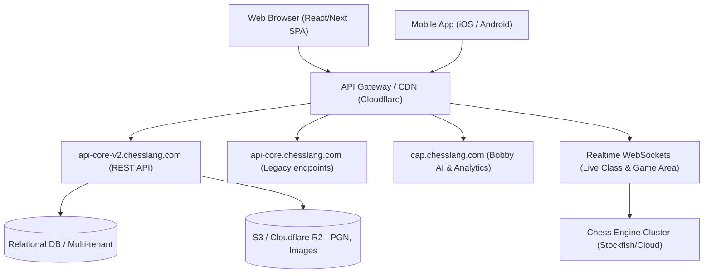

# Đặc tả Kỹ thuật & Giải mã Chức năng: Chesslang.com vs ERPChess

## Tài liệu 00: Tổng quan Kiến trúc & Bản đồ Chức năng Toàn diện

> **Mã định danh:** REA-SPEC-00  
> **Nguồn đối chứng:** `https://platform.chesslang.com` (Tài khoản khảo sát: `duongsinhchess` / Academy: `Dương Sinh chess CLB`)  
> **Dữ liệu giải mã:** `rea/evidence/chesslang-deep-audit.json`, `rea/evidence/screenshots/`, `rea/ledger.md`  
> **Mục tiêu:** Xây dựng phần mềm ERPChess hoàn thiện trên cả 3 nền tảng Web, Desktop (Tauri) và Mobile (Expo) với trải nghiệm tương đương hoặc vượt trội so với Chesslang.

---

### 1. Kiến trúc Hệ thống của Chesslang (Phân tích từ REA)

Qua dữ liệu giám sát mạng và giao diện thu thập từ `platform.chesslang.com`, hệ sinh thái của Chesslang bao gồm các dịch vụ thành phần:

#### Phân tích chi tiết các miền API của Chesslang:

1. **Core API (`api-core-v2.chesslang.com/api/v2/`)**:
   - `auth/token`: Quản lý JWT token và phiên đăng nhập đa vai trò.
   - `identity/profile/me`: Thông tin người dùng hiện tại (roles, email, avatar, academy affiliations).
   - `academies`, `academy/preferences`, `academy/logo`, `academy/favicon`: Cơ chế White-label đa học viện (Multi-tenant).
   - `user/preferences`, `user/theme-preferences`: Cài đặt cá nhân (bàn cờ, âm thanh, tọa độ, ký hiệu nước đi).
   - `dashboard/feed/upcoming`, `dashboard/feed/weekly-stats`, `dashboard/learners/top`: Cụm dữ liệu bảng điều khiển trung tâm.
   - `students`, `coaches`, `batches`: Quản lý nhân sự, học viên, phân lớp theo trình độ.
   - `sessions`: Lịch trình các buổi học trực tuyến (Classrooms) theo dải ngày.
   - `tournaments`, `coach-tournaments`: Tổ chức và điều phối giải đấu.
2. **Bobby AI Engine & Orchestrator (`cap.chesslang.com/api/orchestrator/bobby/reports`)**:
   - Tự động quét ván cờ, phát hiện lỗi ngớ ngẩn (blunders), nước đi hay (brilliant) và xuất báo cáo tiến bộ.
3. **Tracking & Analytics (`rybbit.shortcastle.com`)**:
   - Đo lường hành vi học viên, thời gian làm bài tập và tỷ lệ tương tác.

---

### 2. Bản đồ 16 Phân hệ Chức năng của Chesslang

|  STT   | Phân hệ (Chesslang Route)              | Chức năng nghiệp vụ chính                                                                     | Trạng thái ERPChess hiện tại                   | Mục tiêu hoàn thiện                                                                        |
| :----: | -------------------------------------- | --------------------------------------------------------------------------------------------- | ---------------------------------------------- | ------------------------------------------------------------------------------------------ |
| **01** | `/dashboard`                           | Bảng điều khiển tổng quan, Quick Actions, Lịch học sắp tới, Thống kê tuần, Top học viên       | Đã có widget và quick actions (PR 15a)         | Thêm feed hoạt động chi tiết, biểu đồ trực quan, tích hợp sâu đa học viện                  |
| **02** | `/classrooms` (`/classes`)             | Lớp học trực tuyến tương tác, đồng bộ bàn cờ thời gian thực, audio/video, phân quyền học viên | Đã có LiveKit + Board Web sync cơ bản          | Hoàn thiện chế độ tương tác đa bàn cờ, ghi chú HLV, mute/unmute, bài tập trong lớp         |
| **03** | `/administration/students`             | Quản lý học viên, tạo mã, phân lớp (batches), cấp độ (kiwi/elo), phụ huynh, trạng thái        | Đã có danh sách members, thêm học viên         | Thêm lọc batch, gán cấp độ có màu, lịch sử học tập, import/export danh sách                |
| **04** | `/coaches`                             | Quản lý ban huấn luyện viên, phân công lớp học, theo dõi giờ dạy                              | Đã có vai trò coach trong academy              | Bổ sung giao diện quản lý hồ sơ HLV, phân quyền lớp học cụ thể                             |
| **05** | `/batches`                             | Phân nhóm học viên theo trình độ (nhập môn, trung cấp, đội tuyển)                             | Đã có trường level/groups                      | Giao diện quản lý lớp/batch chuyên biệt, xếp lịch theo batch                               |
| **06** | `/assignment` (`/assignment/exercise`) | Quản lý và giao bài tập thế cờ, chấm điểm tự động, deadline, theo dõi nộp bài                 | Đã có giao bài, bảng attempts, sync-shared     | Hoàn thiện giao diện chọn bài theo cây thư mục FEN, chấm nhiều nước đi, feedback giáo viên |
| **07** | `/quiz/list`                           | Trắc nghiệm cờ vua có giới hạn thời gian, câu hỏi lý thuyết & thế cờ                          | Đã có bảng quiz, làm bài quiz                  | Bổ sung chế độ trắc nghiệm tính giờ từng câu, xem lại lời giải chi tiết, phân tích điểm    |
| **08** | `/course` (`/course/list`)             | Khóa học theo giáo trình, lộ trình bài giảng lý thuyết + thực hành                            | Đã có học liệu cơ bản                          | Xây dựng phân hệ Courseware có cấu trúc bài học, video nhúng, bài kiểm tra cuối bài        |
| **09** | `/practice`                            | Luyện tập thế cờ theo chủ đề/chương (tactics drills), lưu tiến độ                             | Đã có Practice Chapters (PR 15b)               | Bổ sung thêm kho bài tập phân loại theo chủ đề (Pin, Fork, Skewer, Mate in 1/2/3)          |
| **10** | `/board` & `/database`                 | Bàn cờ phân tích Masterbase, nạp PGN, tra cứu ván đấu đại kiện tướng, Arasan NNUE eval        | Đã có GameViewer + EvalBar (PR 15b)            | Bổ sung cây biến thể (Opening Tree), tìm kiếm theo thế cờ/FEN, tra cứu người chơi          |
| **11** | `/study` (`/study/list`)               | Học liệu tương tác, vẽ mũi tên/highlight ô cờ, ghi chú, chia sẻ học viện                      | Đã có Study & Chapters                         | Bổ sung công cụ vẽ mũi tên trực quan trên bàn cờ, xuất nhập PGN có comment                 |
| **12** | `/game-area`                           | Khu vực thi đấu tự do, Đấu Bot Arasan 7 cấp, Thách đấu 1 chạm, Học viên online                | Đã có Bot Arena 7 cấp + Modal thách đấu        | Bổ sung hàng đợi ghép cặp tự động (Auto Matchmaking), lịch sử ván cờ, bảng xếp hạng        |
| **13** | `/simul`                               | Đấu cờ đồng loạt (Simultaneous Exhibition) giữa HLV và nhiều học viên                         | Đã có schema simul                             | Giao diện HLV quan sát lưới nhiều bàn cờ đồng thời, chuyển nhanh bàn chưa đi nước          |
| **14** | `/tournaments`                         | Giải đấu nội bộ (Hệ Thụy Sĩ, Vòng tròn, Đấu trường Arena), ghép cặp tự động                   | Đã có tournament engine                        | Giao diện bảng ghép cặp trực quan, bảng xếp hạng tự động cập nhật, đồng hồ ván đấu         |
| **15** | `/reports` (`/reports/coach`)          | Báo cáo chi tiết hoạt động học viên, tiến độ làm bài, điểm thi, xuất CSV/PDF                  | Đã có xuất CSV báo cáo học viên (Giai đoạn 13) | Bổ sung biểu đồ tiến bộ theo thời gian, báo cáo chuyên sâu theo từng kỹ năng               |
| **16** | `/preferences` & `/chat`               | Tùy biến bàn cờ/theme, múi giờ, ngôn ngữ, chat nội bộ học viện                                | Đã có i18n, cài đặt cá nhân                    | Bổ sung hệ thống chat thời gian thực (nhóm lớp, cá nhân), cấu hình thương hiệu CLB         |

---

### 3. Nguyên tắc Kiến trúc Toàn diện của ERPChess

1. **Chuẩn mã nguồn sạch:**
   - Hoàn toàn bằng TypeScript / Rust / SQL. Tuyệt đối **không dùng mã nguồn GPL**.
   - Phân tầng rõ rệt: `@erpchess/domain`, `@erpchess/chess-core`, `@erpchess/engine`, `@erpchess/api`, `@erpchess/board-web`, `@erpchess/ui-tokens`.
2. **Đồng bộ đa nền tảng (Web, Desktop Tauri, Mobile Expo):**
   - Web: Vite + React Router v7 + Tailwind CSS v4.
   - Desktop: Tauri v2 + Rust đóng gói Web SPA, engine Arasan native cực nhanh.
   - Mobile: Expo v54 + React Native, sử dụng chung logic từ `@erpchess/domain` và `@erpchess/chess-core`.
3. **Bảo mật và toàn vẹn dữ liệu:**
   - Cơ chế bảo mật hàng (PostgreSQL RLS) trên Supabase. Không dùng lệnh nguy hiểm `DROP` hay `DELETE` trong schema migrations.
   - Chấm bài tập và phân tích nước đi phía server hoặc Edge Functions với bộ core chuẩn xác.
