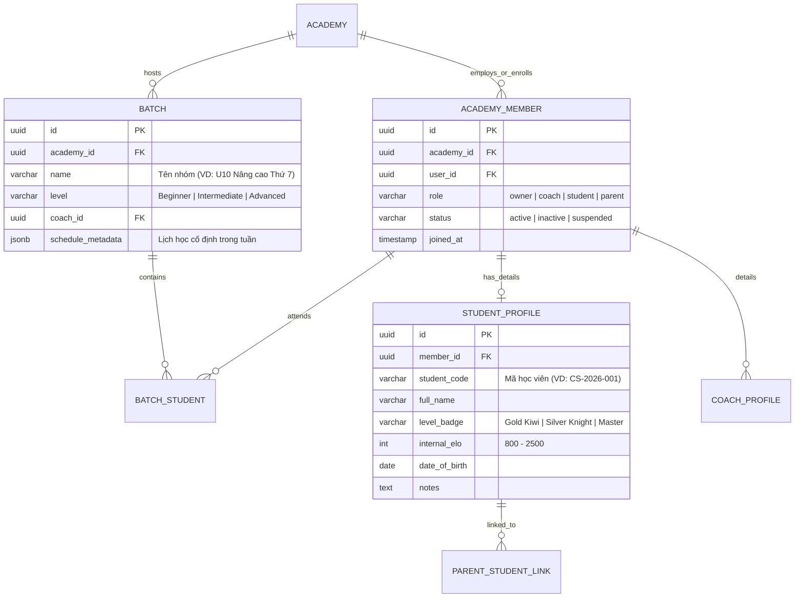

# Đặc tả Kỹ thuật & Giải mã Chức năng: Chesslang.com vs ERPChess

## Tài liệu 02: Phân hệ Quản trị Học viên, Huấn luyện viên & Phân lớp (Batches)

> **Mã định danh:** REA-SPEC-02  
> **Route đối chứng:** `https://platform.chesslang.com/administration/students`, `/coaches`, `/batches`  
> **Ảnh chụp bằng chứng:** `rea/evidence/screenshots/route_administration_students.png`, `route_students.png`, `route_batches.png`  
> **API giám sát:** `api/v2/students?includeInactive=true`, `api/v2/coaches`, `api/v2/identity/profile/me`

---

### 1. Mục tiêu Nghiệp vụ & Yêu cầu Quản lý Học viện Cờ vua

Một học viện cờ vua chuyên nghiệp đòi hỏi quản lý chính xác:
1. **Học viên (Students):** Mỗi em có trình độ khởi điểm (Elo hoặc hệ thống cấp độ nội bộ như Gold Kiwi, Green Pawn, v.v.), có thông tin liên hệ phụ huynh, và được phân bổ vào các nhóm học phù hợp.
2. **Nhóm/Lớp học (Batches / Cohorts):** Gom các học viên có cùng trình độ hoặc cùng ca học vào một nhóm để thuận tiện giao bài tập hàng loạt và xếp lịch học.
3. **Huấn luyện viên (Coaches):** Đội ngũ HLV chịu trách nhiệm đứng lớp, giao bài tập, chấm điểm và theo dõi sự tiến bộ của từng học viên.
4. **Phụ huynh (Parents):** Được liên kết với tài khoản của con để nhận thông báo vắng/nghỉ, kết quả làm bài tập và biên lai học phí.

---

### 2. Sơ đồ Kiến trúc & Quan hệ Dữ liệu

---

### 3. Chi tiết Giao diện & Trải nghiệm Người dùng (UI / UX)

#### 3.1. Danh sách Học viên (`/administration/students`)

- **Bộ lọc & Tìm kiếm:**
  - Ô tìm kiếm tức thì theo tên, mã học viên hoặc email phụ huynh.
  - Bộ lọc theo Lớp/Batch, Cấp độ đào tạo, Trạng thái hoạt động (Đang học / Tạm nghỉ).
- **Cấu trúc Bảng dữ liệu (Data Grid):**
  - Cột 1: Avatar + Họ và tên học viên.
  - Cột 2: Cấp độ (Huy hiệu màu sắc bắt mắt, ví dụ: 🥝 Gold Kiwi, 🛡️ Silver Knight).
  - Cột 3: Lớp/Nhóm (Batch) đang sinh hoạt.
  - Cột 4: Điểm Elo nội bộ / FIDE (nếu có).
  - Cột 5: Tỷ lệ làm bài tập trong tuần (% hoàn thành).
  - Cột 6: Thông tin liên hệ phụ huynh (Tên + Số điện thoại).
  - Cột 7: Thao tác nhanh (Sửa thông tin, Đổi lớp, Xem tiến độ học, Đổi mật khẩu, Khóa/Mở khóa).

#### 3.2. Modal Thêm / Chỉnh sửa Học viên

- **Tab 1 - Thông tin cơ bản:** Họ tên, Ngày sinh, Giới tính, Tên tài khoản, Mật khẩu khởi tạo.
- **Tab 2 - Học vụ:** Phân vào Lớp (Batch), Chọn cấp độ khởi điểm, Elo ban đầu, HLV phụ trách trực tiếp.
- **Tab 3 - Phụ huynh:** Họ tên cha/mẹ, Số điện thoại (Zalo), Email nhận thông báo định kỳ.

#### 3.3. Phân nhóm / Lớp học (`/batches`)

- Danh sách dạng thẻ (Card Grid):
  - Mỗi thẻ hiển thị: Tên lớp, Trình độ mục tiêu, Tên HLV chủ nhiệm, Số học viên hiện tại / Tối đa, Lịch học định kỳ (VD: Thứ 3 & Thứ 6 lúc 18:30).
  - Nút bấm nhanh: "+ Thêm học viên vào lớp", "Giao bài tập cho cả lớp", "Lịch học của lớp".

#### 3.4. Đội ngũ Huấn luyện viên (`/coaches`)

- Danh sách HLV trực thuộc học viện.
- Hiển thị danh hiệu cờ vua (GM, IM, FM, National Master, HLV Quốc Gia).
- Thống kê: Số lớp phụ trách, tổng số học viên quản lý, số giờ đã đứng lớp trong tháng.

---

### 4. Quy tắc Nghiệp vụ & Ràng buộc Bảo mật (Business Rules & RLS)

1. **Ràng buộc vai trò (Role-Based Access Control):**
   - `Owner`: Toàn quyền thêm, xóa, sửa học viên, HLV và học phí.
   - `Coach`: Chỉ xem và quản lý học viên thuộc các Batch mà mình phụ trách; được quyền chấm bài và cập nhật ghi chú học vụ.
   - `Student`: Chỉ xem hồ sơ cá nhân của mình, danh sách bạn cùng lớp, không xem được thông tin liên hệ của học viên khác.
   - `Parent`: Chỉ xem dữ liệu của con mình đã được xác thực liên kết.
2. **Không xóa vật lý (Soft Delete):**
   - Học viên nghỉ học chuyển `status = 'inactive'`, bảo lưu toàn bộ lịch sử nộp bài, ván cờ và điểm thi.
   - Tuyệt đối không xóa dữ liệu làm mất tính toàn vẹn của báo cáo lịch sử.

---

### 5. Hạng mục Cần Hoàn thiện trong ERPChess

1. **Giao diện Quản lý Học viên Chuyên biệt:** Nâng cấp từ trang `a.$slug.members.tsx` thành màn hình `Administration > Students` chuyên nghiệp tương tự Chesslang với bảng thông tin đầy đủ và modal chi tiết.
2. **Hệ thống Cấp độ Đào tạo (Kiwi / Level Badges):** Cho phép Học viện tự định nghĩa các cấp độ (Level config: Tên, Màu sắc, Biểu tượng, Elo yêu cầu).
3. **Phân hệ Batches (Lớp học):** Bổ sung trang quản lý Batches với giao diện quản lý danh sách học viên theo nhóm trực quan.
