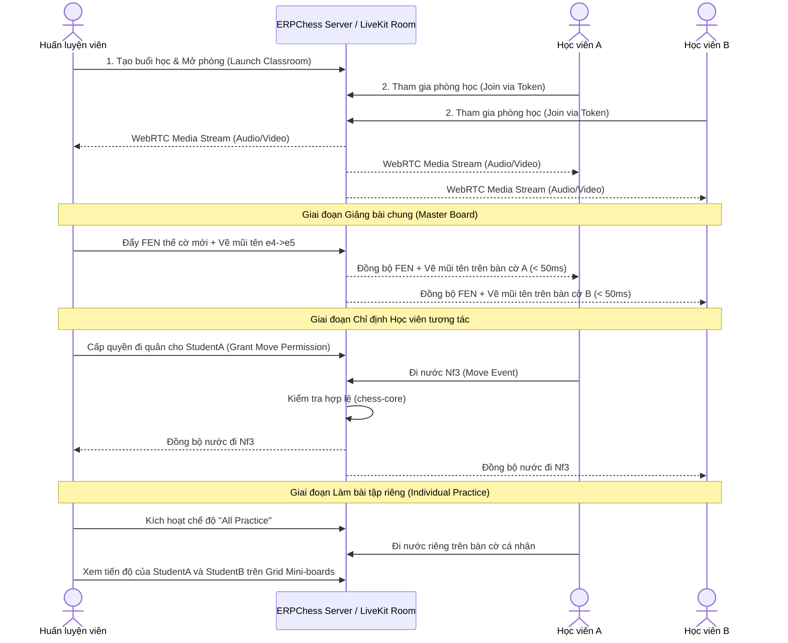

# Đặc tả Kỹ thuật & Giải mã Chức năng: Chesslang.com vs ERPChess

## Tài liệu 03: Phân hệ Lớp học Trực tuyến Tương tác (Interactive Classrooms)

> **Mã định danh:** REA-SPEC-03  
> **Route đối chứng:** `https://platform.chesslang.com/classrooms`, `/classes`  
> **Ảnh chụp bằng chứng:** `rea/evidence/screenshots/route_classrooms.png`, `route_classes.png`  
> **Hạ tầng thời gian thực:** WebRTC Audio/Video (LiveKit Cloud/Self-hosted) + WebSockets State Sync

---

### 1. Mục tiêu Nghiệp vụ & Bản chất Cốt lõi của Lớp học Cờ vua Trực tuyến

Khác với các ứng dụng họp trực tuyến thông thường (Zoom, Google Meet), một lớp học cờ vua trực tuyến chuyên nghiệp đòi hỏi **sự tương tác đồng thời giữa Giọng nói/Hình ảnh (Audio/Video) và Bàn cờ Cờ vua Tương tác thời gian thực (Interactive Chessboard)**.

Huấn luyện viên không chỉ "chia sẻ màn hình" mà còn phải:
1. **Kiểm soát quyền đi quân (Turn & Move Permission):** Cho phép học viên A thử nước đi trên bàn cờ chính, trong khi các học viên khác chỉ quan sát.
2. **Bàn cờ học viên độc lập (Student Boards):** Cho cả lớp cùng giải một thế cờ trên bàn cờ riêng của từng em; HLV có thể nhìn lướt qua (grid preview) toàn bộ bàn cờ của các học viên để biết em nào đã tìm ra nước đi đúng.
3. **Công cụ minh họa trực quan:** Vẽ mũi tên chiến thuật (màu xanh lá, đỏ, vàng), đánh dấu ô cờ điểm yếu/mạnh, ghi chú biến thể phụ.
4. **Quản lý phòng học:** Bật/tắt mic học viên, giơ tay phát biểu, chat trong lớp.

---

### 2. Sơ đồ Kiến trúc & Luồng Dữ liệu Thời gian thực



---

### 3. Cấu trúc Giao diện Phòng học (Classroom UI Layout)

```
+-----------------------------------------------------------------------------------------+
| [Header] Tên lớp | Đang diễn ra: 45:12 | [Mic] [Cam] [Chia sẻ màn hình] | [Rời lớp]     |
+-------------------------------------------------------------+---------------------------+
| [Vùng Giảng dạy Chính - 70% Chiều rộng]                     | [Sidebar Tương tác - 30%] |
|                                                             |                           |
|      +-------------------------------------------+          | 1. Video Grid:            |
|      |                                           |          |    [Avatar HLV (Video)]   |
|      |                                           |          |    [Học viên A] [HV B]    |
|      |                                           |          |                           |
|      |             BÀN CỜ TƯƠNG TÁC              |          | 2. Tab Điều khiển:        |
|      |             (Interactive Board)           |          |    [Danh sách HV] [Chat]  |
|      |                                           |          |                           |
|      |                                           |          | 3. Công cụ Giảng viên:    |
|      |                                           |          |    - Quyền đi quân: [HV A]|
|      +-------------------------------------------+          |    - Nạp thế cờ (FEN)     |
|                                                             |    - Mở bài tập / PGN     |
| [Thanh Công cụ dưới Bàn cờ]:                                |    - Reset bàn cờ         |
| [|<] [<<] [>>] [>|] | [Lật cờ] | [Vẽ mũi tên] | [Xóa vẽ]   |    - Chế độ: [Cả lớp giải]|
+-------------------------------------------------------------+---------------------------+
```

---

### 4. Chi tiết Kỹ thuật của Bàn cờ Giảng dạy

#### 4.1. Đồng bộ Trạng thái Bàn cờ (Board State Sync)

- Sử dụng gói dữ liệu JSON nhỏ gọn truyền qua kênh Data Packet của LiveKit (DataChannel) với độ trễ siêu thấp (< 30ms):
```typescript
type BoardSyncMessage =
  | { type: 'SET_POSITION'; fen: string; pgn?: string }
  | { type: 'MAKE_MOVE'; from: string; to: string; promotion?: string; san: string }
  | {
      type: 'DRAW_SHAPE';
      shape: {
        type: 'arrow' | 'circle';
        from: string;
        to?: string;
        color: 'green' | 'red' | 'blue' | 'yellow';
      };
    }
  | { type: 'CLEAR_SHAPES' }
  | { type: 'SET_CONTROL'; activeStudentId: string | 'all' | 'none' }
  | { type: 'MODE_CHANGE'; mode: 'lecture' | 'practice_individual' };
```

#### 4.2. Khắc phục Xung đột Nước đi (Conflict Resolution)

- HLV luôn giữ quyền ưu tiên cao nhất (`master_priority = true`).
- Nếu học viên đi một nước không hợp lệ theo luật cờ, client tự động hoàn tác (snap-back) mà không phát sóng ra phòng học.
- Mọi nước đi đều được thẩm định bởi `@erpchess/chess-core` trước khi phát sinh sự kiện.

---

### 5. Hạng mục Cần Hoàn thiện trong ERPChess

1. **Bộ công cụ Giảng dạy Nâng cao (Coach Teaching Toolbar):** Bổ sung nút vẽ mũi tên chiến thuật (Right-click drag hoặc chạm 2 ngón), đánh dấu ô vuông màu sắc trực quan trên component `BoardWeb`.
2. **Cơ chế Cấp quyền Đi quân Tức thì (Interactive Turn Delegation):** Cho phép HLV click vào avatar học viên trong danh sách để bật "Cho phép thao tác bàn cờ".
3. **Tích hợp Kho Thế cờ Nhanh (Quick FEN Injector):** Nút chọn bài tập từ phân hệ Practice / Studies để đưa thẳng lên bàn cờ lớp học mà không cần copy paste FEN thủ công.
