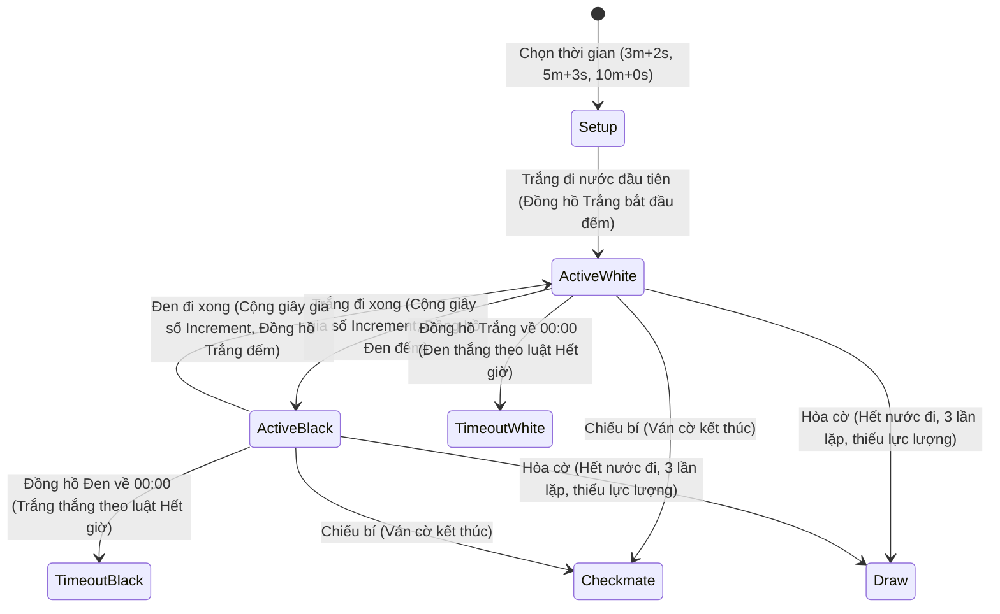

# Đặc tả Kỹ thuật & Giải mã Chức năng: Chesslang.com vs ERPChess

## Tài liệu 06: Phân hệ Thi đấu (Game Area), Đấu Bot, Đấu đồng loạt (Simul) & Giải đấu (Tournaments)

> **Mã định danh:** REA-SPEC-06  
> **Route đối chứng:** `https://platform.chesslang.com/game-area`, `/simul`, `/tournaments`  
> **Ảnh chụp bằng chứng:** `rea/evidence/screenshots/route_game_area.png`, `route_simul.png`, `route_tournaments.png`  
> **Động cơ thi đấu:** Arasan Chess Engine + Realtime Matchmaking & Tournament Manager

---

### 1. Mục tiêu Nghiệp vụ & Các Hình thức Thi đấu

Hệ thống thi đấu giúp học viên cọ xát thực chiến, tích lũy kinh nghiệm và rèn luyện tâm lý thi đấu theo luật FIDE:
1. **Đấu Bot Luyện tập (Bot Arena):**
   - 7 cấp độ Bot mô phỏng từ người mới học (Elo 800) đến Đại kiện tướng quốc tế (Elo 2600+).
   - Mỗi Bot có tính cách, avatar đại diện, phong cách thi đấu riêng (Thích tấn công, Phòng thủ chắc chắn, Chiến thuật linh hoạt).
   - Có đồng hồ tính giờ thực tế (3 phút Blitz, 5 phút Rapid, 10 phút, không giới hạn).
2. **Khu vực Thách đấu Trực tuyến (Game Area / Online Matches):**
   - Danh sách học viên đang trực tuyến trong học viện.
   - Nút "Thách đấu 1 chạm (⚔️ Challenge)": Tùy chọn thời gian và màu quân (Trắng / Đen / Ngẫu nhiên).
   - Hàng đợi tìm trận tự động (Quick Pairing) giữa các học viên có cùng Elo.
3. **Đấu cờ Đồng loạt (Simultaneous Exhibition - Simul):**
   - Huấn luyện viên mở bàn đấu đồng loạt với 5 đến 30 học viên cùng lúc.
   - HLV đi một nước trên từng bàn; khi đi xong, bàn cờ tự động chuyển sang bàn tiếp theo có học viên đã đi nước đáp trả.
4. **Giải đấu Học viện (Internal Tournaments):**
   - Thể thức Hệ Thụy Sĩ (Swiss System) chuẩn FIDE: Ghép cặp theo điểm số, không gặp lại đối thủ cũ.
   - Thể thức Đấu vòng tròn (Round Robin): Mọi kỳ thủ đều gặp nhau.
   - Thể thức Đấu trường (Arena): Thi đấu liên tục tính điểm theo chuỗi thắng (Streak bonus).

---

### 2. Chi tiết 7 Cấp độ Bot Thi đấu Arasan

| Cấp độ | Tên Bot                                 | Elo Ước tính | Độ sâu tính toán | Thời gian nghĩ | Phong cách thi đấu                                |
| :----: | --------------------------------------- | :----------: | :--------------: | :------------: | ------------------------------------------------- |
| **1**  | Tân binh Tò mò (Pawn Scout)             |   **800**    |     Depth 2      |     200ms      | Đi quân cơ bản, thỉnh thoảng bỏ sót đòn bắt quân  |
| **2**  | Kỵ sĩ Tập sự (Knight Squire)            |   **1100**   |     Depth 4      |     400ms      | Chú ý an toàn Vua, biết tấn công ô cờ yếu         |
| **3**  | Giám mục Chiến thuật (Bishop Tactician) |   **1400**   |     Depth 6      |     600ms      | Thích tìm đòn ghim, đòn chĩa, đổi quân hợp lý     |
| **4**  | Xe Tấn công (Rook Vanguard)             |   **1700**   |     Depth 9      |     900ms      | Khai cuộc bài bản, kiểm soát cột mở vững chắc     |
| **5**  | Hậu Sắc bén (Queen Strategist)          |   **2000**   |     Depth 13     |     1200ms     | Trung cuộc sắc sảo, tính toán biến thể nhiều nước |
| **6**  | Vua Bậc thầy (King Master)              |   **2300**   |     Depth 17     |     1800ms     | Kỹ thuật tàn cuộc chuẩn xác, phòng thủ kiên cường |
| **7**  | Đại kiện tướng Arasan NNUE              |  **2600+**   |    Depth 22+     |     2500ms     | Sức mạnh tối đa của mạng neuron nhân tạo NNUE     |

---

### 3. Đồng hồ Thi đấu & Xử lý Thời gian Thực (Chess Clocks)



---

### 4. Giao diện Đấu Đồng loạt (Simultaneous Exhibition Layout)

```
+-----------------------------------------------------------------------------------------+
| [HLV Dashboard Simul] Đang đấu 12 bàn | Thắng: 4 | Hòa: 1 | Bại: 0 | Còn lại: 7         |
+-----------------------------------------------------------------------------------------+
| [Bàn 1: Học viên Tuấn]      | [Bàn 2: Học viên Mai]       | [Bàn 3: Học viên Long]      |
| [Mini-Board 1]              | [Mini-Board 2] (Đến lượt HLV)| [Mini-Board 3]             |
| Trắng: HLV - Đen: Tuấn (10m)| Trắng: HLV - Đen: Mai (8m)  | Trắng: HLV - Đen: Long (9m) |
| [Đang chờ đối thủ...]       | [>>> Bấm để đi nước <<<]    | [Đang chờ đối thủ...]       |
+-----------------------------+-----------------------------+-----------------------------+
| [Bàn 4: Học viên An]        | [Bàn 5: Học viên Trang]     | [Bàn 6: Học viên Bình]      |
| [Mini-Board 4]              | [Mini-Board 5]              | [Mini-Board 6]              |
+-----------------------------------------------------------------------------------------+
```

- Khi học viên đi một nước, bàn cờ của học viên đó trên màn hình HLV sẽ phát sáng viền xanh lá và rung nhẹ âm thanh báo hiệu.
- HLV có thể click trực tiếp vào bàn cờ đó để mở to (Focus view) hoặc đi nhanh ngay trên bàn cờ thu nhỏ.

---

### 5. Hạng mục Cần Hoàn thiện trong ERPChess

1. **Bộ Ghép Cặp Tự Động (Auto Matchmaking Queue):** Bổ sung nút "Tìm trận nhanh" với bộ đếm thời gian chờ tìm đối thủ có cùng Elo trong học viện.
2. **Giao diện Giám sát Đấu đồng loạt (Simul Host Grid):** Hoàn thiện component hiển thị nhiều bàn cờ trực quan cho HLV điều phối buổi đấu đồng loạt.
3. **Bảng Xếp hạng & Kết quả Giải đấu Trực tiếp (Live Standings):** Tự động tính điểm hệ số Tie-break (Buchholz, Sonneborn-Berger) và cập nhật thời gian thực khi mỗi ván đấu kết thúc.
