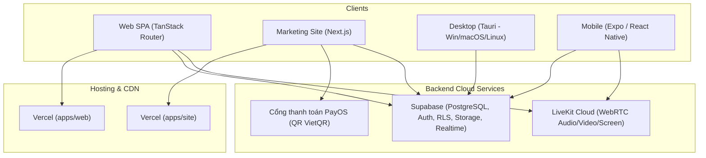

# Hướng dẫn triển khai và vận hành ERPChess

Tài liệu này hướng dẫn chi tiết quy trình triển khai toàn bộ các dịch vụ và thành phần của nền tảng ERPChess trên môi trường Staging và Production.

---

## 1. Kiến trúc hệ thống tổng thể



---

## 2. Triển khai Cơ sở dữ liệu (Supabase)

### 2.1. Cấu hình dự án

1. Đăng ký/đăng nhập [Supabase Dashboard](https://supabase.com).
2. Tạo dự án mới:
   - **Name:** `erpchess-production`
   - **Region:** `Southeast Asia (Singapore)` (đảm bảo độ trễ thấp nhất cho Việt Nam).
   - **Database Password:** Lưu vào trình quản lý khóa bảo mật.

### 2.2. Áp dụng Database Migrations

Tất cả các bản migration nằm trong thư mục `supabase/migrations/`:
- Dự án tuân thủ nghiêm ngặt **nguyên tắc kế toán REA** và **chỉ append-only** (không bao giờ dùng `DROP` hay `DELETE` trong migration).
- Sử dụng Supabase CLI để đồng bộ schema:
```bash
# Đăng nhập Supabase CLI
supabase login

# Liên kết với dự án production
supabase link --project-ref <YOUR_PROJECT_REF>

# Đẩy toàn bộ migrations lên cơ sở dữ liệu
supabase db push
```

### 2.3. Cấu hình Storage Bucket

Tạo bucket lưu trữ công khai/bán công khai trong Supabase Storage:
- **Bucket `avatars`:** Công khai (public), cho phép tải lên avatar học viên và câu lạc bộ.
- **Bucket `materials`:** Riêng tư (private), có chính sách RLS chỉ cho phép giáo viên/học viên trong lớp tải tài liệu cờ.

### 2.4. Khóa bảo mật & Biến môi trường

Cần lưu các giá trị từ Supabase API Settings:
- `SUPABASE_URL`: Đường dẫn API dự án (ví dụ `https://xyz.supabase.co`).
- `SUPABASE_ANON_KEY`: Khóa công khai cho client (Web, Mobile, Desktop).
- `SUPABASE_SERVICE_ROLE_KEY`: Khóa đặc quyền cao dành riêng cho backend webhook/worker (không bao giờ đưa vào client).

---

## 3. Triển khai Ứng dụng Web & Landing Site (Vercel)

### 3.1. Ứng dụng Quản lý & Lớp học (`apps/web`)

1. Kết nối kho mã nguồn GitHub với Vercel.
2. Thiết lập dự án:
   - **Framework Preset:** `Vite`
   - **Root Directory:** `apps/web`
   - **Build Command:** `pnpm build`
   - **Output Directory:** `dist`
3. Biến môi trường:
   - `VITE_SUPABASE_URL`: `<SUPABASE_URL>`
   - `VITE_SUPABASE_ANON_KEY`: `<SUPABASE_ANON_KEY>`
   - `VITE_LIVEKIT_WS_URL`: `wss://your-livekit-domain.livekit.cloud`
4. Cấu hình `vercel.json`: Đã bao gồm tiêu đề `Cross-Origin-Opener-Policy: same-origin` và `Cross-Origin-Embedder-Policy: require-corp` để hỗ trợ Web Worker chạy Arasan Chess Engine (WASM + SharedArrayBuffer).

### 3.2. Cổng thông tin & Thanh toán (`apps/site`)

1. Thiết lập dự án mới trên Vercel:
   - **Framework Preset:** `Next.js`
   - **Root Directory:** `apps/site`
   - **Build Command:** `pnpm build`
2. Biến môi trường:
   - `NEXT_PUBLIC_SITE_URL`: `https://erpchess.com`
   - `PAYOS_CLIENT_ID`: Khóa ứng dụng PayOS
   - `PAYOS_API_KEY`: API Key PayOS
   - `PAYOS_CHECKSUM_KEY`: Checksum Key PayOS
   - `SUPABASE_URL` và `SUPABASE_SERVICE_ROLE_KEY`: Đồng bộ trạng thái hóa đơn/gói thuê bao.
3. Health check:
   - Endpoint giám sát tự động: `https://erpchess.com/api/health`

---

## 4. Triển khai Dịch vụ Phòng học Trực tuyến (LiveKit)

1. Sử dụng [LiveKit Cloud](https://livekit.io/) hoặc tự host phiên bản mã nguồn mở trên máy chủ riêng qua Docker.
2. Lấy thông tin xác thực:
   - `LIVEKIT_URL`: Địa chỉ máy chủ WebSocket (ví dụ: `wss://erpchess.livekit.cloud`).
   - `LIVEKIT_API_KEY`: API Key.
   - `LIVEKIT_API_SECRET`: Secret Key để ký JWT token cho giáo viên và học viên.
3. Cấp phát token:
   - Sử dụng Supabase Edge Function hoặc API route để ký token người dùng theo từng phòng học `room:<class_id>`, phân quyền giáo viên (`canPublish: true`, `canPublishSources: ['camera', 'microphone', 'screen_share']`) và học viên (`canPublishSources: ['camera', 'microphone']`).

---

## 5. Đóng gói & Phát hành Mobile (Expo EAS)

### 5.1. Chuẩn bị

1. Cài đặt EAS CLI:

   ```bash
   npm install -g eas-cli
   eas login
   ```
2. Thư mục `apps/mobile` đã được cấu hình sẵn file `eas.json` với 3 môi trường:
   - `development`: Dùng để lập trình cùng Expo Go / Custom Dev Client.
   - `preview`: Đóng gói file APK (Android) / IPA nội bộ (Ad-Hoc iOS) để kiểm thử nội bộ.
   - `production`: Xuất file Android App Bundle (`.aab`) và chuẩn bị cho Apple App Store.

### 5.2. Lệnh đóng gói

```bash
cd apps/mobile

# Build APK kiểm thử cho Android
eas build --profile preview --platform android

# Build AAB phát hành Google Play
eas build --profile production --platform android

# Build iOS cho TestFlight / App Store
eas build --profile production --platform ios
```

### 5.3. Cập nhật không cần cài lại (OTA Updates)

Khi sửa lỗi nhỏ hoặc cập nhật giao diện mà không thay đổi mã native:
```bash
eas update --channel production --message "Sửa lỗi hiển thị bàn cờ"
```

---

## 6. Đóng gói & Phát hành Desktop (Tauri)

### 6.1. Quy trình CI/CD tự động

Dự án sử dụng GitHub Actions workflow `.github/workflows/release-desktop.yml`:
- Khi tạo và đẩy một git tag mới định dạng `v*` (ví dụ `v1.0.0`):

  ```bash
  git tag v1.0.0
  git push origin v1.0.0
  ```
- Workflow sẽ tự động kích hoạt trên 3 hệ điều hành:
  - **Windows (x64):** Xuất bản `.exe` (NSIS Installer) và `.msi`.
  - **macOS (Universal/Intel/Silicon):** Xuất bản `.dmg` và `.app.tar.gz`.
  - **Linux (x64):** Xuất bản `.AppImage` và `.deb`.
- Các file cài đặt sẽ tự động được tải lên mục **Releases** của GitHub Repository.

### 6.2. Đóng gói thủ công tại máy cục bộ (Local Build)

Yêu cầu: Máy đã cài đặt Rust, Cargo và Node.js.
```bash
# Đóng gói ứng dụng desktop trên máy hiện tại
pnpm --filter @erpchess/desktop bundle
```
File cài đặt sau khi hoàn tất sẽ nằm trong thư mục:
`apps/desktop/src-tauri/target/release/bundle/`.

---

## 7. Giám sát hệ thống & Xử lý sự cố

1. **Client Error Telemetry:**
   - Client được tích hợp `AppErrorBoundary` và module `src/lib/telemetry.ts`.
   - Nếu cấu hình Sentry DSN, mọi ngoại lệ render và runtime crash sẽ được tự động báo cáo về dashboard giám sát kèm component stack.
2. **API Health Check:**
   - Dịch vụ Uptime Robot hoặc BetterStack giám sát định kỳ 1 phút/lần vào `GET /api/health` của trang site.
3. **Sao lưu dữ liệu:**
   - Supabase tự động sao lưu dữ liệu mỗi ngày (Daily Backup với Point-In-Time Recovery cho bản Pro).
