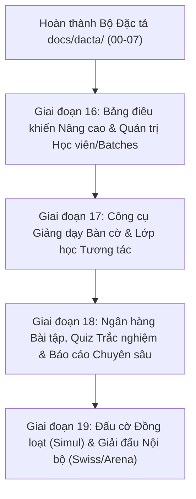

# Kế hoạch Hoàn thiện Toàn diện ERPChess theo Đặc tả Giải mã Chesslang (REA)

> **Mã kế hoạch:** PLAN-PHASE-16  
> **Căn cứ đặc tả:** Bộ tài liệu đặc tả `docs/dacta/00-` đến `docs/dacta/07-`  
> **Đối tượng đối chứng:** Hệ thống quản lý đào tạo `chesslang.com` (Tài khoản: `duongsinhchess`)  
> **Cam kết chất lượng:** Đồng bộ 3 nền tảng Web, Desktop Tauri, Mobile Expo; Không mã GPL; Không xóa dữ liệu vật lý (No DELETE/DROP); CI 3/3 jobs xanh trước khi merge.

---

## 1. Lộ trình Triển khai Phân kỳ (Roadmap)

---

## 2. Chi tiết Giai đoạn 16: Quản trị Học vụ & Phân lớp Batches (Triển khai Ngay)

Giai đoạn 16 tập trung giải quyết triệt để 2 vấn đề mà người dùng nhận xét "còn sơ sài" ở khâu quản trị và theo dõi học viện:

### **PR 16a: Bảng điều khiển Nâng cao & Khởi tạo Lớp học Nhanh** (✅ ĐÃ HOÀN THÀNH & MERGE #36)

- **Mục tiêu:** Nâng cấp Dashboard Overview với biểu đồ hoạt động tuần trực quan và Modal tạo nhanh buổi học (Quick Session Modal).
- **Kết quả nghiệm thu:**
  1. **Weekly Activity Chart:** Biểu đồ cột SVG/Tailwind mượt mà hiển thị số bài tập học viên giải theo từng thứ trong tuần (Thứ 2 đến Chủ nhật) kèm tooltip chi tiết và chỉ số tổng/trung bình ngày.
  2. **Modal Khởi tạo Lớp học Nhanh (Quick Session Modal):** Nhấn nút `Tạo lớp học` trên thanh Quick Actions bật modal cho phép nhập Tên lớp, chọn HLV, chọn Nhóm học viên (Batch), chọn ngày giờ và tạo ngay buổi học trực tuyến LiveKit.
  3. **Tối ưu CI:** Thêm `DEBIAN_FRONTEND=noninteractive` và `--no-install-recommends` cho bước cài đặt thư viện hệ thống của Tauri, rút ngắn thời gian chạy CI xuống 55s.
  4. **Kiểm thử tự động:** Hoàn tất 7 unit tests mới, 100% CI 3/3 jobs xanh. PR #36 đã được merge vào `main` tại commit `0f20602`.

---

### **PR 16b: Phân hệ Quản trị Học viên Chuyên sâu & Phân lớp Batches** (✅ ĐÃ HOÀN THÀNH & MERGE #37)

- **Mục tiêu:** Xây dựng màn hình Quản lý Học viên chuyên nghiệp (`/administration/students`) và Quản lý Nhóm/Lớp (`/batches`) tương ứng với đặc tả `REA-SPEC-02`.
- **Kết quả nghiệm thu:**
  1. **Huy hiệu Cấp độ Kiwi Level (`LevelBadge.tsx`):** Hiển thị huy hiệu đẹp mắt kèm màu sắc, biểu tượng tương ứng theo từng bậc (Gold Kiwi, Silver Knight, Bronze Pawn, Master...).
  2. **Bảng Quản trị Học viên (`StudentAdminTable.tsx`):**
     - Bảng danh sách trực quan với Avatar, Tên, Username, Cấp độ, Lớp/Batch, Điểm Elo Rapid, Nút mời phụ huynh.
     - Ô tìm kiếm tức thì và bộ lọc đa tiêu chí (theo Lớp/Batch, theo Cấp độ).
     - Đổi cấp độ trực tiếp ngay trên hàng học viên.
     - Chỉnh sửa Elo tức thì đồng bộ CSDL.
  3. **Màn hình Quản lý Nhóm/Lớp Batches (`a.$slug.batches.tsx`):**
     - Hiển thị danh sách các lớp học/nhóm dạng Card Grid sinh động kèm Huấn luyện viên phụ trách, sĩ số học viên và lịch học định kỳ trong tuần.
     - Modal Sĩ số thành viên (`BatchRosterModal`) cho phép xem và thêm/bớt học viên một chạm.
     - Modal Tạo nhóm/lớp mới (`CreateBatchModal`) kèm chọn HLV và cấp độ mục tiêu.
  4. **Tương thích URL Chesslang:** Bổ sung route alias `/administration/students` và `/batches`, cập nhật Command Palette (`Ctrl+K`).
  5. **Kiểm thử tự động:** Hoàn tất 6 unit tests mới (`LevelBadge.test.tsx`, `StudentAdminTable.test.tsx`), 47 tests passed, 3/3 jobs CI xanh. PR #37 đã được merge vào `main` tại commit `e1618b0`.

---

## 3. Chi tiết Giai đoạn 17: Công cụ Giảng dạy Bàn cờ & Lớp học Tương tác LiveKit (Tiếp theo)

Giai đoạn 17 hiện thực hóa các yêu cầu tại `docs/dacta/03-lop-hoc-tuong-tac-classroom.md` và `docs/dacta/05-ban-co-hoc-lieu-study-database.md`:

### **PR 17a: Nâng cấp Bàn cờ Giảng dạy Tương tác (Interactive Classroom Board)**
- **Mục tiêu:** Nâng cấp bàn cờ lớp học trực tuyến (`apps/web/src/routes/a.$slug.classes.$id.room.tsx`) với đầy đủ tính năng sư phạm:
  1. **Công cụ vẽ hình sư phạm (Annotations):**
     - Chuột phải kéo thả vẽ mũi tên (xanh lá, đỏ, vàng, xanh dương).
     - Chuột phải bấm tô màu ô cờ để làm nổi bật ô chiến thuật.
     - Nút xóa nhanh toàn bộ chú thích trên bàn cờ.
  2. **Thanh đánh giá EvalBar & Engine Arasan tích hợp trong lớp học:**
     - Tích hợp EvalBar động hiển thị lợi thế điểm số (+1.5, -2.3, M3...).
     - Phân tích nước đi trực tiếp cho HLV (giấu hoặc hiện với học viên tùy quyền).
  3. **Cơ chế Phân quyền Đi quân (Turn & Move Permission):**
     - HLV có nút trao quyền đi quân cho học viên bất kỳ hoặc chuyển chế độ Free Play / Coach Only.
     - Trạng thái đồng bộ tức thì qua kênh Realtime Supabase Broadcast.

### **PR 17b: Nâng cấp LiveKit Video Grid & Bảng điều khiển Lớp học**
- **Mục tiêu:** Hoàn thiện giao diện phòng học trực tuyến LiveKit:
  1. **Video Layouts:** Hỗ trợ 3 chế độ xem (Chế độ Bàn cờ tập trung Board-focused, Chế độ Hội nghị Gallery Grid, Chế độ Diễn giả Speaker).
  2. **Điều khiển Lớp học cho HLV:** Quản lý Mic/Camera học viên (Mute all, Tắt camera khi cần), giơ tay phát biểu (Raise Hand).
  3. **Bảng trò chuyện lớp học (In-class Chat):** Chat tin nhắn có preview FEN thế cờ thu nhỏ.

---

## 4. Quy trình Kiểm thử & Nghiệm thu (Verification Gate)

Mỗi PR trước khi tạo và merge phải vượt qua toàn bộ các bước kiểm tra tự động:
1. `pnpm lint` (Biome check không cảnh báo/lỗi).
2. `pnpm typecheck` (TypeScript strict mode pass 100%).
3. `pnpm test` (Toàn bộ unit test & integration test pass).
4. `pnpm build` (Build web thành công, hoàn tác `apps/site/next-env.d.ts` nếu bị sửa).
5. `pnpm --filter @erpchess/mobile export:web` (Mobile Expo bundle pass).
6. `cargo check --manifest-path apps/desktop/src-tauri/Cargo.toml` (Desktop Tauri pass).
7. GitHub Actions CI 3/3 jobs xanh (`Lint, typecheck, test, build`, `Tauri cargo check`, `Arasan native + WASM`).
8. Cập nhật sổ cái REA (`rea/ledger.md`) và kế hoạch `docs/plans/`.
