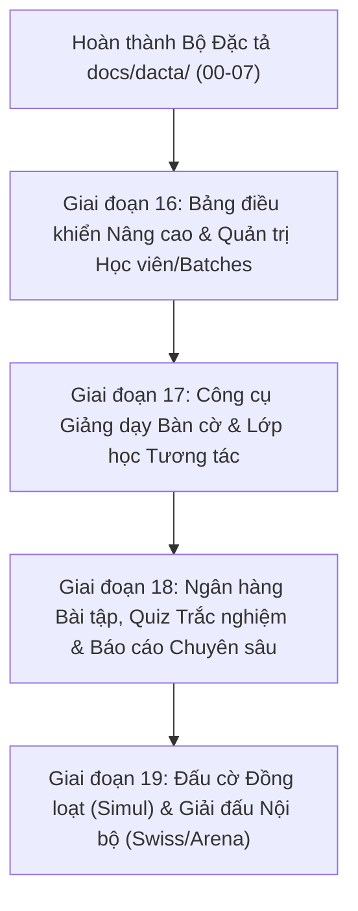

# Kế hoạch Hoàn thiện Toàn diện ERPChess theo Đặc tả Giải mã Chesslang (REA)

> **Mã kế hoạch:** PLAN-PHASE-16  
> **Căn cứ đặc tả:** Bộ tài liệu đặc tả `docs/dacta/00-` đến `docs/dacta/07-`  
> **Đối tượng đối chứng:** Hệ thống quản lý đào tạo `chesslang.com` (Tài khoản: `duongsinhchess`)  
> **Cam kết chất lượng:** Đồng bộ 3 nền tảng Web, Desktop Tauri, Mobile Expo; Không mã GPL; Không xóa dữ liệu vật lý (No DELETE/DROP); CI 3/3 jobs xanh trước khi merge.

---

## 1. Lộ trình Triển khai Phân kỳ (Roadmap)

---

## 2. Chi tiết Giai đoạn 16: Quản trị Học vụ & Phân lớp Batches (Triển khai Ngay)

Giai đoạn 16 tập trung giải quyết triệt để 2 vấn đề mà người dùng nhận xét "còn sơ sài" ở khâu quản trị và theo dõi học viện:

### **PR 16a: Bảng điều khiển Nâng cao & Khởi tạo Lớp học Nhanh** (✅ ĐÃ HOÀN THÀNH & MERGE #36)

- **Mục tiêu:** Nâng cấp Dashboard Overview với biểu đồ hoạt động tuần trực quan và Modal tạo nhanh buổi học (Quick Session Modal).
- **Kết quả nghiệm thu:**
  1. **Weekly Activity Chart:** Biểu đồ cột SVG/Tailwind mượt mà hiển thị số bài tập học viên giải theo từng thứ trong tuần (Thứ 2 đến Chủ nhật) kèm tooltip chi tiết và chỉ số tổng/trung bình ngày.
  2. **Modal Khởi tạo Lớp học Nhanh (Quick Session Modal):** Nhấn nút `Tạo lớp học` trên thanh Quick Actions bật modal cho phép nhập Tên lớp, chọn HLV, chọn Nhóm học viên (Batch), chọn ngày giờ và tạo ngay buổi học trực tuyến LiveKit.
  3. **Tối ưu CI:** Thêm `DEBIAN_FRONTEND=noninteractive` và `--no-install-recommends` cho bước cài đặt thư viện hệ thống của Tauri, rút ngắn thời gian chạy CI xuống 55s.
  4. **Kiểm thử tự động:** Hoàn tất 7 unit tests mới, 100% CI 3/3 jobs xanh. PR #36 đã được merge vào `main` tại commit `0f20602`.

---

### **PR 16b: Phân hệ Quản trị Học viên Chuyên sâu & Phân lớp Batches** (✅ ĐÃ HOÀN THÀNH & MERGE #37)

- **Mục tiêu:** Xây dựng màn hình Quản lý Học viên chuyên nghiệp (`/administration/students`) và Quản lý Nhóm/Lớp (`/batches`) tương ứng với đặc tả `REA-SPEC-02`.
- **Kết quả nghiệm thu:**
  1. **Huy hiệu Cấp độ Kiwi Level (`LevelBadge.tsx`):** Hiển thị huy hiệu đẹp mắt kèm màu sắc, biểu tượng tương ứng theo từng bậc (Gold Kiwi, Silver Knight, Bronze Pawn, Master...).
  2. **Bảng Quản trị Học viên (`StudentAdminTable.tsx`):**
     - Bảng danh sách trực quan với Avatar, Tên, Username, Cấp độ, Lớp/Batch, Điểm Elo Rapid, Nút mời phụ huynh.
     - Ô tìm kiếm tức thì và bộ lọc đa tiêu chí (theo Lớp/Batch, theo Cấp độ).
     - Đổi cấp độ trực tiếp ngay trên hàng học viên.
     - Chỉnh sửa Elo tức thì đồng bộ CSDL.
  3. **Màn hình Quản lý Nhóm/Lớp Batches (`a.$slug.batches.tsx`):**
     - Hiển thị danh sách các lớp học/nhóm dạng Card Grid sinh động kèm Huấn luyện viên phụ trách, sĩ số học viên và lịch học định kỳ trong tuần.
     - Modal Sĩ số thành viên (`BatchRosterModal`) cho phép xem và thêm/bớt học viên một chạm.
     - Modal Tạo nhóm/lớp mới (`CreateBatchModal`) kèm chọn HLV và cấp độ mục tiêu.
  4. **Tương thích URL Chesslang:** Bổ sung route alias `/administration/students` và `/batches`, cập nhật Command Palette (`Ctrl+K`).
  5. **Kiểm thử tự động:** Hoàn tất 6 unit tests mới (`LevelBadge.test.tsx`, `StudentAdminTable.test.tsx`), 47 tests passed, 3/3 jobs CI xanh. PR #37 đã được merge vào `main` tại commit `e1618b0`.

---

## 3. Chi tiết Giai đoạn 17: Công cụ Giảng dạy Bàn cờ & Lớp học Tương tác LiveKit (Tiếp theo)

Giai đoạn 17 hiện thực hóa các yêu cầu tại `docs/dacta/03-lop-hoc-tuong-tac-classroom.md` và `docs/dacta/05-ban-co-hoc-lieu-study-database.md`:

### **PR 17a: Nâng cấp Bàn cờ Giảng dạy Tương tác (Interactive Classroom Board)** (✅ ĐÃ HOÀN THÀNH & MERGE #38)

- **Mục tiêu:** Nâng cấp bàn cờ lớp học trực tuyến (`apps/web/src/routes/a.$slug.classes.$id.room.tsx`) với đầy đủ tính năng sư phạm theo đặc tả `docs/dacta/03-lop-hoc-tuong-tac-classroom.md`.
- **Kết quả nghiệm thu:**
  1. **Thanh công cụ Giảng dạy Bàn cờ (`ClassroomToolbar.tsx`):**
     - Nút lật bàn cờ nhìn bên Trắng/Đen linh hoạt.
     - Nút xóa nét vẽ (Clear Drawings) một chạm.
     - Công cụ sư phạm HLV: Hoàn tác nước đi (Undo), Tạo ván mới (Reset), Bật/Tắt phân tích động cơ Arasan NNUE và ô nạp chuỗi FEN thế cờ trực tiếp với kiểm tra tính hợp lệ tức thì.
  2. **Quản lý Thành viên & Trao quyền Đi cờ (`ClassroomRoster.tsx`):**
     - Hiển thị danh sách học viên và HLV với avatar chữ cái và chức danh.
     - Badge trực quan `Đang đi cờ ♟️` chỉ rõ người đang được trao quyền thao tác trên bàn cờ chính.
     - Nút `Cho đi cờ ♟` và `Hủy quyền ✕` một chạm dành riêng cho HLV.
     - Nút `Thu quyền về HLV` trên thanh tiêu đề để thu hồi quyền tức thì.
  3. **Thanh đánh giá Thế trận (`EvalBar.tsx`) trong Phòng học:**
     - Tích hợp thanh EvalBar đứng dọc cạnh bàn cờ lớp học, co giãn mượt mà theo điểm số của động cơ Arasan NNUE.
  4. **Chia sẻ Thế cờ vào Khung Chat:**
     - Nút `Chia sẻ FEN ♟` trên tiêu đề ChatBox cho phép gửi thế cờ hiện tại vào khung chat lớp học.
  5. **Kiểm thử tự động:** Hoàn tất 7 unit tests mới cho `ClassroomToolbar` và `ClassroomRoster`, 20/20 test files và 54 tests trong `@erpchess/web` pass 100%, 3/3 jobs CI xanh. PR #38 đã được merge vào `main` tại commit `09db234`.

### **PR 17b: Nâng cấp LiveKit Video Grid & Bảng điều khiển Lớp học** (✅ ĐÃ HOÀN THÀNH & MERGE #39)

- **Mục tiêu:** Hoàn thiện giao diện phòng học trực tuyến LiveKit theo đặc tả `docs/dacta/03-lop-hoc-tuong-tac-classroom.md`:
- **Kết quả nghiệm thu:**
  1. **Chế độ Bố cục Phòng học Linh hoạt (Layout Modes):**
     - Hỗ trợ 3 chế độ xem: **Bàn cờ tập trung (Board-focused)** (70% bàn cờ, 30% sidebar), **Chia đôi màn hình (Split 50-50)**, và **Hội nghị (Gallery Grid)** (Video toàn màn hình phía trên).
     - Bộ chuyển layout 1-chạm mượt mà ngay trên thanh tiêu đề phòng học.
  2. **Nâng cấp LiveKit VideoPanel (`VideoPanel.tsx`):**
     - Điều chỉnh chiều cao linh hoạt theo chế độ xem (sidebar 240px, grid 400px, theater 500px).
     - Bổ sung tính năng `Tắt tiếng tất cả (Mute All)` cho HLV quản lý âm thanh cả lớp.
  3. **Tương tác Giơ tay Phát biểu (Raise Hand ✋):**
     - Học viên có nút `✋ Giơ tay phát biểu` / `✋ Hạ tay xuống` đồng bộ thời gian thực.
     - Biểu tượng ✋ hiển thị cạnh tên học viên trong `ClassroomRoster`.
     - HLV có nút `Mời đi cờ ✋` ưu tiên học viên giơ tay và nút `Hạ tay (N)` toàn lớp.
  4. **Khung Chat Lớp học Chuyên nghiệp:**
     - Tự động nhận diện và định dạng badge thông báo sự kiện giơ tay, hạ tay và FEN cờ vua.
  5. **Kiểm thử tự động:** Bổ sung unit tests cho tương tác giơ tay, toàn bộ 55 unit tests của `@erpchess/web` pass 100%, 3/3 jobs CI xanh. PR #39 đã được merge vào `main` tại commit `bae388d`.

---

## 4. Chi tiết Giai đoạn 18: Ngân hàng Bài tập, Quiz Trắc nghiệm & Báo cáo Chuyên sâu (Tiếp theo)

Giai đoạn 18 hiện thực hóa các yêu cầu tại `docs/dacta/04-bai-tap-quiz-luyen-tap.md` và `docs/dacta/07-bao-cao-hoc-vien-chat-cai-dat.md`:

### **PR 18a: Phân hệ Ngân hàng Bài tập (Exercises) & Luyện thế cờ (Practice)** (✅ ĐÃ HOÀN THÀNH & MERGE #40)

- **Mục tiêu:** Hoàn thiện phân hệ Ngân hàng Bài tập và tương thích URL theo đặc tả `docs/dacta/04-bai-tap-quiz-luyen-tap.md`:
- **Kết quả nghiệm thu:**
  1. **Ngân hàng Bài tập Nâng cao (`Exercises.tsx`):**
     - Thanh tìm kiếm bài tập tức thì theo tiêu đề hoặc thẻ tag (`#fork`, `#pin`, `#mate`...).
     - Bộ lọc cấp độ đào tạo (Level) kết nối trực tiếp với CSDL học viện.
     - Thiết kế giao diện thẻ bài tập trực quan hiển thị số lượng thế cờ, cấp độ gán và số lần đã giao.
  2. **Tương thích hoàn toàn URL Chesslang (Route Aliases):**
     - Bổ sung route alias `/assignment/exercise` tự động điều hướng vào Ngân hàng Bài tập.
     - Bổ sung route alias `/practice` tự động điều hướng vào phân hệ Luyện tập Thế cờ theo chương.
     - Bổ sung route alias `/quiz/list` tự động điều hướng vào danh mục Trắc nghiệm Tính giờ.
  3. **Tích hợp Command Palette (`Ctrl+K`):**
     - Bổ sung các lệnh truy cập nhanh vào Ngân hàng Bài tập, Luyện tập Thế cờ và Trắc nghiệm.
  4. **Kiểm thử tự động:** Hoàn tất 4 unit tests mới cho `Exercises.test.tsx`, toàn bộ 59 unit tests của `@erpchess/web` pass 100%, 3/3 jobs CI xanh. PR #40 đã được merge vào `main` tại commit `eb7d1c7`.

### **PR 18b: Quiz Trắc nghiệm Tính giờ & Báo cáo Tiến độ Học viên Chuyên sâu** (✅ ĐÃ HOÀN THÀNH)

- **Mục tiêu & Kết quả nghiệm thu:**
  1. **Quiz Trắc nghiệm Tính giờ (`QuizTaker.tsx`):**
     - Đồng hồ đếm ngược từng câu (`QuestionTimer` 60s) kèm hiệu ứng đổi màu cảnh báo (vàng < 15s, đỏ nhấp nháy < 5s) và khóa thao tác khi hết thời gian (`timeUp`).
     - Chế độ làm bài tập trung toàn màn hình (Focus Mode ⛶) loại bỏ các yếu tố gây xao nhãng.
     - Thẻ tổng kết kết quả làm bài trực quan (`QuizSummaryCard`): tỷ lệ chính xác %, điểm số/tối đa, thời gian và huy hiệu đánh giá thành tích.
  2. **Báo cáo Tiến độ Chuyên sâu & Phiếu Điểm In ấn (`/reports` & `PrintableReportCard.tsx`):**
     - Bổ sung bộ lọc theo Lớp/Nhóm (Batch Filter) kết hợp `useGroups` và `useGroupStudentIds` lọc tức thì cả bảng toàn học viện và danh sách học viên.
     - Mẫu Phiếu Báo Cáo Kết Quả Học Tập A4 in ấn chuẩn quốc tế (`PrintableReportCard`): Logo học viện, thông tin học viên, 4 thẻ chỉ số cốt lõi (Bài tập, Quiz, Chuyên cần, Elo), Biểu đồ năng lực 4 trụ cột cờ vua (Khai cuộc, Chiến thuật, Tính toán, Tàn cuộc), Nhận xét HLV và khu vực ký duyệt, hỗ trợ `window.print()` và CSS in ấn sạch sẽ.
  3. **Kiểm thử tự động:** Hoàn tất 6 unit tests mới (`QuizTaker.test.tsx`, `PrintableReportCard.test.tsx`), toàn bộ 65 unit tests của `@erpchess/web` pass 100%, typecheck và build xanh 100%.

---

## 5. Kế hoạch Giai đoạn 19: Đấu cờ Đồng loạt Simul & Phân hệ Giải đấu Swiss/Arena

Giai đoạn 19 hiện thực hóa các yêu cầu tại `docs/dacta/06-thi-dau-game-area-bot-simul-giai.md`:
### **PR 19a: Đấu cờ Đồng loạt (Simul Exhibition Multi-board Console)** (✅ ĐÃ HOÀN THÀNH)

- **Mục tiêu & Kết quả nghiệm thu:**
  1. **Bảng Điều Khiển Đấu Đồng Loạt Chuyên Nghiệp (`a.$slug.simuls.$id.tsx`):**
     - HLV điều hành đồng thời nhiều bàn cờ (Multi-board View) với thanh tỷ số trực quan (Thắng / Hòa / Thua) và tổng điểm tích lũy.
     - Bộ lọc bàn cờ 4 chế độ: `Tất cả`, `⚡ Đến lượt tôi (My Turn)`, `Đang chờ đối thủ`, `Đã kết thúc`.
     - Bàn cờ đang chờ HLV đi được ghim huy hiệu động nhấp nháy nổi bật và tự động xếp ưu tiên lên đầu.
  2. **Modal Đi Nước Nhanh Trực Tiếp (`SimulQuickPlayModal.tsx`):**
     - Cho phép HLV đi cờ trực tiếp ngay trên trang Simul mà không cần tải lại hay chuyển trang rời khỏi giao diện tổng quan.
     - Nút tự động chuyển sang bàn tiếp theo đang chờ HLV (`Next Active Board ⏭️`) giúp luân chuyển ván đấu mượt mà, tối ưu trải nghiệm đấu đồng loạt.
     - Hiển thị thời gian đồng hồ hai bên, quân cờ bị bắt và tên học viên đối thủ.
  3. **Tương thích Route Aliases & Command Palette:**
     - Route aliases tương thích Chesslang: `/simul` và `/game-area/simul`.
     - Tích hợp Command Palette `Ctrl+K` truy cập nhanh vào Đấu cờ Đồng loạt (`simul.commandTitle`).
  4. **Kiểm thử tự động:** Hoàn tất 3 unit tests mới (`SimulQuickPlayModal.test.tsx`), toàn bộ 68 unit tests của `@erpchess/web` pass 100%, typecheck, lint, build, mobile export và desktop cargo check xanh 100%.

---

### **PR 19b: Phân hệ Giải đấu Nội bộ (Swiss System & Arena Tournaments & Live Standings)** (✅ ĐÃ HOÀN THÀNH)

- **Mục tiêu & Kết quả nghiệm thu:**
  1. **Bảng Xếp Hạng Trực Tiếp Nâng Cao (Live Standings):**
     - Hiển thị huy chương 🥇 Quán quân, 🥈 Á quân, 🥉 Hạng 3 cho top 3 kỳ thủ dẫn đầu.
     - Badge động nhấp nháy `⚡ Trực tiếp (Live)` khi giải đấu đang diễn ra.
     - Tự động tính điểm hệ số Buchholz Cut 1, Sonneborn-Berger và số ván thắng theo chuẩn FIDE.
  2. **Chế độ Xem Lưới Bàn Cờ Trực Tiếp (Live Board Grid):**
     - Component mới `TournamentLiveBoardGrid.tsx` cho phép HLV và kỳ thủ xem trực quan các bàn cờ trong vòng thi đấu.
     - Hiển thị thời gian đồng hồ từng bên, quân cờ bị bắt, nước đi cuối cùng và nhãn trạng thái bàn cờ.
     - Nút chuyển đổi mượt mà giữa chế độ Danh sách (`viewModeList`) và Lưới bàn cờ (`viewModeGrid`).
  3. **Thanh Tiến Độ & Bộ Lọc Ván Đấu:**
     - Thanh thống kê tiến độ vòng: `X / Y ván đã xong`.
     - Bộ lọc ván đấu 3 chế độ: Tất cả ván (`all`), Đang diễn ra (`active`), Đã hoàn tất (`finished`).
  4. **Tương thích Route Aliases & Điều hướng:**
     - Route aliases tương thích Chesslang: `/tournaments` và `/game-area/tournaments`.
     - Tích hợp Command Palette `Ctrl+K` truy cập nhanh vào Giải đấu.
  5. **Kiểm thử tự động:** Hoàn tất 4 unit tests mới (`TournamentLiveBoardGrid.test.tsx`), toàn bộ 72 unit tests của `@erpchess/web` pass 100%, 11/11 packages typecheck passed, 100% Biome linting clean. Hoàn thành toàn diện Giai đoạn 19!

---

## 6. Kế hoạch Giai đoạn 20: Tùy biến Bàn cờ Thời gian Thực & Cấu hình Sở thích (Preferences)

Giai đoạn 20 hiện thực hóa các yêu cầu tại `docs/dacta/07-bao-cao-hoc-vien-chat-cai-dat.md`:

### **PR 20a: Bộ Tùy biến Bàn cờ Thời gian Thực (Live Board Customizer & Preferences)** (✅ ĐÃ HOÀN THÀNH)

- **Mục tiêu & Kết quả nghiệm thu:**
  1. **Hỗ trợ 5 Theme Màu Sắc Bàn Cờ Đỉnh Cao trong `@erpchess/board-web`:**
     - `navy` (Mặc định Dương Sinh Navy: Light `#E8EBF7`, Dark `#7C88C9`).
     - `green` (Cẩm thạch Xanh giải đấu: Light `#EEEED2`, Dark `#769656`).
     - `wood` (Gỗ Cổ điển: Light `#F0D9B5`, Dark `#B58863`).
     - `blue` (Xanh Đại dương: Light `#DEE3E6`, Dark `#8CA2AD`).
     - `charcoal` (Xám Kim loại hiện đại: Light `#E0E0E0`, Dark `#4E545C`).
  2. **Quản lý Cài đặt Bền vững (`useBoardPreferences.ts`):**
     - Lưu trữ cấu hình `theme`, `coordinates`, `soundEnabled`, `autoFlip` vào `localStorage`.
     - Đồng bộ thời gian thực qua CustomEvent giữa các tab và component trên trang.
  3. **Thẻ Tùy Biến Bàn Cờ Trực Quan (`BoardPreferencesCard.tsx`):**
     - Thẻ swatch màu thực tế cho từng theme.
     - Công tắc bật/tắt Tọa độ viền bàn cờ a-h, 1-8.
     - Công tắc bật/tắt Âm thanh nước đi và Tự động xoay bàn theo lượt.
     - Bàn cờ Live Preview hiển thị thế trận mẫu cập nhật tức thời khi đổi cấu hình.
  4. **Tương thích Route Aliases & Điều hướng:**
     - Route aliases tương thích Chesslang: `/preferences` và `/settings`.
     - Tích hợp Command Palette `Ctrl+K` truy cập nhanh vào Tùy biến bàn cờ (`nav-board-preferences`).
  5. **Kiểm thử tự động:** Hoàn tất 4 unit tests mới (`BoardPreferencesCard.test.tsx`), toàn bộ 76 unit tests của `@erpchess/web` pass 100%, 11/11 packages typecheck passed, 100% Biome linting clean.

### **PR 20b: Áp dụng tùy chọn bàn cờ cho mọi trang, âm thanh và tự xoay bàn** (✅ ĐÃ HOÀN THÀNH)

- **Mục tiêu & Kết quả nghiệm thu:**
  1. **`PreferredBoard` (`apps/web/src/components/board/PreferredBoard.tsx`):** lớp bọc `<Board>` đọc `useBoardPreferences`, truyền `theme`/`coordinates`; prop truyền vào luôn thắng cài đặt (bàn thu nhỏ giữ `coordinates={false}`). Thay cho `<Board>` ở 15 file web: phân tích, ván online, đấu bot, lớp học (room/replay), simul, giải đấu, bài tập, quiz, study.
  2. **Âm thanh nước đi (`apps/web/src/lib/board-sound.ts`):** tổng hợp bằng WebAudio (không dùng file âm thanh), 3 loại: đi quân, ăn quân (số quân giảm), chiếu. Chỉ phát khi FEN đổi kèm `lastMove`, không phát ở lần vẽ đầu; tôn trọng `soundEnabled`; prop `sound={false}` tắt hẳn cho lưới nhiều bàn và ảnh thu nhỏ.
  3. **Tự xoay bàn theo lượt:** `autoFlipOrientation` áp dụng ở bàn phân tích (một người đi cả hai bên); nút lật thủ công vẫn hoạt động (đảo so với bên đến lượt), EvalBar xoay theo. Ván online, lớp học, simul giữ hướng theo màu quân.
  4. **Kiểm thử tự động:** thêm `PreferredBoard.test.tsx` (6 test) và `board-sound.test.ts` (4 test).
- **Còn lại cho PR 20c:** đồng bộ cài đặt lên hồ sơ server, bộ quân cờ (piece set), áp dụng cài đặt cho mobile.

### **PR 20c: Đồng bộ tùy chọn bàn cờ lên hồ sơ và bộ quân thứ hai** (✅ ĐÃ HOÀN THÀNH)

- **Mục tiêu & Kết quả nghiệm thu:**
  1. **DB:** migration `20261030000026_profiles_board_preferences.sql` thêm `profiles.board_preferences jsonb not null default '{}'` (bắt buộc là object, ≤ 2 KB); pgTAP `19_profiles_board_preferences.sql`.
  2. **Domain:** `boardPreferencesSchema`, `DEFAULT_BOARD_PREFERENCES`, `normalizeBoardPreferences` (trường sai/thiếu lấy mặc định) dùng chung web/mobile; `updateProfileSchema`/`updateProfile` nhận `boardPreferences`.
  3. **Bộ quân spatial** (Maurizio Monge, MIT, kèm LICENSE) từ `vendor/arasan`; `board-web` có `PIECE_SETS` và prop `pieceSet`; `BoardPreferencesCard` có ô chọn bộ quân; `PreferredBoard` truyền `pieceSet`.
  4. **Đồng bộ (`BoardPreferencesSync`, gắn trong `Shell` khi đăng nhập):** server có cài đặt thì nạp về localStorage; server trống mà máy có cài đặt thì đẩy lên; các thay đổi sau đó lưu lên server, gộp trong 800 ms.
  5. **Kiểm thử:** `BoardPreferencesSync.test.tsx` (5), thêm test pieceSet cho `Board` và `BoardPreferencesCard`, 2 test domain.
- **Còn lại cho PR 20d (mobile):** `board-native` nhận `theme`/`pieceSet` (sinh cả 2 bộ quân), mobile đọc `board_preferences` từ hồ sơ cho các màn có bàn cờ, màn hồ sơ mobile có phần chỉnh cài đặt bàn cờ.

### **PR 20d: Cài đặt bàn cờ trên mobile** (✅ ĐÃ HOÀN THÀNH)

- **Mục tiêu & Kết quả nghiệm thu:**
  1. **Bảng màu dùng chung:** `BOARD_THEMES` tách ra `@erpchess/board-web/themes` (không kéo theo React DOM), `board-native` re-export.
  2. **`board-native`:** prop `theme` và `pieceSet`; `scripts/gen-pieces.mjs` sinh `PIECE_SETS_XML` cho celtic và spatial, gắn tiền tố id theo từng quân (`spatial-wN-…`) để gradient không trùng id khi export web.
  3. **Mobile `PreferredBoard`** (`apps/mobile/src/components/PreferredBoard.tsx`): đọc `profiles.board_preferences` qua `useProfile`, áp dụng cho 6 file có bàn cờ (phân tích, lớp học, ván đấu, quiz, ActivityPlayer, PuzzleSolver).
  4. **Màn hồ sơ mobile:** chọn theme (kèm ô màu), bộ quân, tọa độ, bàn cờ xem trước; lưu cùng nút "Lưu", giữ nguyên âm thanh/tự xoay đã đặt trên web.
- **Chưa làm:** âm thanh và tự xoay bàn trên mobile.

## 6b. Giai đoạn 21: Tính năng cờ vua trong Chat (docs/dacta/07 mục 3.2)

### **PR 21a: Chia sẻ thế cờ (FEN) và ván cờ (PGN) trong chat** (✅ ĐÃ HOÀN THÀNH)

- **Mục tiêu & Kết quả nghiệm thu:**
  1. **`detectChessShare` (`packages/chess-core/src/share.ts`):** nhận FEN hợp lệ trong tin nhắn (tự thêm bộ đếm nếu thiếu, giữ phần chữ trước/sau) hoặc PGN có ít nhất một nước (rút tên kỳ thủ, kết quả, giải, thế cuối qua `gameSummary`). Không đổi DB: tin nhắn vẫn là văn bản.
  2. **Chat web:** `ChatMessageBody` vẽ bàn cờ nhỏ cho FEN (xoay theo bên đến lượt) và thẻ ván cho PGN; bấm vào mở `/analysis?fen=` hoặc `/analysis?pgn=` để giải thử/xem ván. Ô soạn đổi sang textarea (Enter gửi, Shift+Enter xuống dòng); danh sách hội thoại hiện nhãn "♟ Thế cờ"/"♟ Ván cờ".
  3. **`/analysis` nhận `?pgn=`** (chỉ khi đọc được, ≤ 4000 ký tự); `AnalysisBoard` có prop `initialPgn`.
  4. **Chat mobile:** cùng cách hiển thị, chạm mở màn phân tích; màn phân tích mobile đọc `fen`/`pgn` từ tham số; ô soạn cho nhiều dòng.
  5. **Kiểm thử:** `share.test.ts` (7), `ChatMessageBody.test.tsx` (4).
- **Giới hạn:** PGN dài hơn 2000 ký tự (ràng buộc `messages.body`) không gửi được; chưa có chia sẻ theo mã bài tập.

## 6c. Giai đoạn 22: White-label học viện, xuất PDF báo cáo, tìm trận nhanh

### **PR 22a: White-label học viện** (✅ ĐÃ HOÀN THÀNH)

- **Mục tiêu & Kết quả nghiệm thu (docs/dacta/07 mục 4.2):**
  1. **DB:** migration `20261031000027_academy_white_label.sql` thêm `academies.favicon_url` (https), `brand_color` (#RRGGBB), `contact` jsonb (địa chỉ, điện thoại, hotline Zalo); bucket công khai `academy-branding` (≤ 1 MB, PNG/JPEG/WebP/SVG/ICO), chỉ chủ học viện được ghi theo thư mục `<academy_id>/`.
  2. **Domain/API:** `academyProfileSchema` nhận `faviconUrl`, `brandColor`, `contact`; `brandColorVars` chọn màu chữ trắng/đen theo độ sáng nền; `uploadAcademyBranding` + hook `useUploadAcademyBranding`.
  3. **Web:** `BrandingCard` (tách ra `components/academy/`) có tải logo/favicon, chọn màu kèm xem trước, thông tin liên hệ; `AcademyContactCard` cho mọi thành viên. Layout học viện ghi đè `--color-primary`/`--color-text-on-primary` trong phạm vi học viện và đổi favicon tab (trả lại khi rời đi).
  4. **Kiểm thử:** 6 test web (`BrandingCard.test.tsx`), 3 test domain, 1 test API.
- **Chưa làm:** áp màu/logo trên mobile; xoá ảnh cũ trong bucket khi thay ảnh mới.

### **PR 22b: Xuất PDF phiếu báo cáo học viên** (✅ ĐÃ HOÀN THÀNH)

- **Mục tiêu & Kết quả nghiệm thu (docs/dacta/07 mục 5.3):**
  1. **Sửa lỗi in trang trắng:** CSS in chỉ cho hiện `.certificate-print`/`.invoice-print` nên phiếu báo cáo (GĐ18b) in ra trang trắng; thêm `.report-print` (định vị tuyệt đối để in được nhiều trang) và `@page A4 portrait`.
  2. **Bỏ số liệu bịa:** phần "Đánh giá năng lực" cũ dùng % cố định (75/80/65) và nhận xét HLV soạn sẵn — thay bằng dữ liệu thật: bài tập, quiz, chuyên cần, ván đấu, giải đấu gần nhất (mỗi mục giới hạn số dòng, rỗng thì ghi "Chưa có dữ liệu").
  3. **White-label trên phiếu:** logo, địa chỉ, điện thoại học viện (từ 22a); khoảng thời gian đang lọc; tên HLV ký là người đang xem (staff).
  4. **Tên tệp PDF:** đặt tiêu đề trang `phieu-bao-cao-<username>-<ngày>` khi in, trả lại sau `afterprint`. Nhận xét HLV để trống thì bản in có dòng kẻ viết tay. Toàn bộ chữ qua i18n vi/en.
  5. **Kiểm thử:** `PrintableReportCard.test.tsx` viết lại (5 test).
- **Ghi chú:** "Xuất PDF" dùng hộp thoại in của trình duyệt (Lưu dưới dạng PDF), không thêm thư viện tạo PDF.

### **PR 22c: Tìm trận nhanh (Auto Matchmaking)** (✅ ĐÃ HOÀN THÀNH)

- **Mục tiêu & Kết quả nghiệm thu (docs/dacta/06 mục 1.2 và 5.1):**
  1. **DB:** migration `20261031000028_match_queue.sql` — bảng `match_queue` (mỗi người một lượt chờ/học viện, chỉ xem lượt của mình), hàm `quick_pair(academy, base_ms, inc_ms)` và `cancel_quick_pair(academy)` chạy `security definer`: vừa giữ chỗ (heartbeat) vừa ghép với người cùng mức thời gian có Elo gần nhất; khoảng chênh ±100, nới 50 mỗi 10 giây, tối đa ±600 (`private.match_window`). Ván tạo ra tính rating theo loại thời gian, màu ngẫu nhiên. Không dùng DELETE: lượt chờ chuyển trạng thái `matched`/`cancelled`, lượt mất heartbeat > 20–30 giây bị bỏ qua.
  2. **API:** `quickPair`, `cancelQuickPair`, `parseQuickPair` (`packages/api/src/games.ts`).
  3. **Web:** `QuickPairCard` trên trang Thi đấu (owner/coach/student): chọn mức thời gian, đếm giây chờ, hiện Elo và khoảng đang tìm, nút huỷ; ghép xong vào thẳng ván. Hook `useQuickPair` gọi lại mỗi 2 giây, rời trang khi đang chờ thì tự rời hàng đợi, huỷ đúng lúc vừa được ghép thì vẫn vào ván.
  4. **Kiểm thử:** pgTAP `20_match_queue.sql` (7), `quick-pair.test.ts` (4), `QuickPairCard.test.tsx` (5).
- **Chưa làm:** tìm trận nhanh trên mobile; chế độ Arena.
- **Lỗi có từ trước:** `ChallengeModal` cho học viên thách đấu chèn trực tiếp vào `games`, nhưng RLS chỉ cho staff ghép cặp → học viên tự thách đấu bị từ chối. **Đã sửa** ở PR sau: migration `20261031000029_create_challenge.sql` thêm RPC `create_challenge` (security definer; người gọi là một trong hai kỳ thủ, cả hai là owner/coach/student của học viện, màu ngẫu nhiên do server bốc, tối đa 3 ván đang diễn ra do mình mở, không giới hạn thời gian thì không tính rating); `ChallengeModal` gọi mutation `challenge` mới; test API + pgTAP `21_create_challenge.sql`.

## 7. Quy trình Kiểm thử & Nghiệm thu (Verification Gate)

Mỗi PR trước khi tạo và merge phải vượt qua toàn bộ các bước kiểm tra tự động:
1. `pnpm lint` (Biome check không cảnh báo/lỗi).
2. `pnpm typecheck` (TypeScript strict mode pass 100%).
3. `pnpm test` (Toàn bộ unit test & integration test pass).
4. `pnpm build` (Build web thành công, hoàn tác `apps/site/next-env.d.ts` nếu bị sửa).
5. `pnpm --filter @erpchess/mobile export:web` (Mobile Expo bundle pass).
6. `cargo check --manifest-path apps/desktop/src-tauri/Cargo.toml` (Desktop Tauri pass).
7. GitHub Actions CI 3/3 jobs xanh (`Lint, typecheck, test, build`, `Tauri cargo check`, `Arasan native + WASM`).
8. Cập nhật sổ cái REA (`rea/ledger.md`) và kế hoạch `docs/plans/`.
