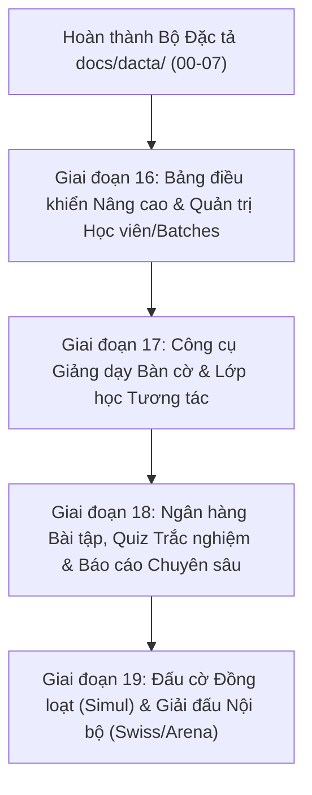

# Kế hoạch Hoàn thiện Toàn diện ERPChess theo Đặc tả Giải mã Chesslang (REA)

> **Mã kế hoạch:** PLAN-PHASE-16  
> **Căn cứ đặc tả:** Bộ tài liệu đặc tả `docs/dacta/00-` đến `docs/dacta/07-`  
> **Đối tượng đối chứng:** Hệ thống quản lý đào tạo `chesslang.com` (Tài khoản: `duongsinhchess`)  
> **Cam kết chất lượng:** Đồng bộ 3 nền tảng Web, Desktop Tauri, Mobile Expo; Không mã GPL; Không xóa dữ liệu vật lý (No DELETE/DROP); CI 3/3 jobs xanh trước khi merge.

---

## 1. Lộ trình Triển khai Phân kỳ (Roadmap)

---

## 2. Chi tiết Giai đoạn 16: Quản trị Học vụ & Phân lớp Batches (Triển khai Ngay)

Giai đoạn 16 tập trung giải quyết triệt để 2 vấn đề mà người dùng nhận xét "còn sơ sài" ở khâu quản trị và theo dõi học viện:

### **PR 16a: Bảng điều khiển Nâng cao & Khởi tạo Lớp học Nhanh**

- **Mục tiêu:** Nâng cấp Dashboard Overview với biểu đồ hoạt động tuần trực quan và Modal tạo nhanh buổi học (Quick Session Modal).
- **Các thành phần cụ thể:**
  1. **Weekly Activity Chart:** Biểu đồ cột SVG/Tailwind mượt mà hiển thị số bài tập học viên giải theo từng thứ trong tuần (Thứ 2 đến Chủ nhật) kèm tooltip chi tiết.
  2. **Modal Khởi tạo Lớp học Nhanh (Quick Session Modal):** Nhấn nút `+ Lớp mới` trên thanh Quick Actions sẽ bật modal cho phép nhập Tên lớp, chọn HLV, chọn Nhóm học viên (Batch), chọn ngày giờ và tạo ngay buổi học trực tuyến.
  3. **Đồng bộ Mobile & Desktop:** Hiển thị widget hoạt động mới trên màn hình Academy Dashboard của Mobile Expo và Desktop Tauri.
- **Nhánh dự kiến:** `feat/giai-doan-16a-dashboard-quick-session`

---

### **PR 16b: Phân hệ Quản trị Học viên Chuyên sâu & Phân lớp Batches**

- **Mục tiêu:** Xây dựng màn hình Quản lý Học viên chuyên nghiệp (`/administration/students`) và Quản lý Nhóm/Lớp (`/batches`) tương ứng với đặc tả `REA-SPEC-02`.
- **Các thành phần cụ thể:**
  1. **Màn hình Administration > Students (`a.$slug.admin.students.tsx`):**
     - Bảng danh sách học viên trực quan với Avatar, Mã học viên, Cấp độ đào tạo, Lớp/Batch, Điểm Elo, Tỷ lệ làm bài tập và thông tin Phụ huynh.
     - Ô tìm kiếm tức thì và bộ lọc đa tiêu chí (theo lớp, theo cấp độ, theo trạng thái).
     - Modal Thêm mới / Chỉnh sửa học viên với 3 tab: Cơ bản, Học vụ và Phụ huynh.
  2. **Hệ thống Cấp độ Đào tạo (Level Badges):**
     - Hiển thị huy hiệu trực quan có biểu tượng và màu sắc sinh động (VD: 🥝 Gold Kiwi, 🛡️ Silver Knight, 👑 Master).
  3. **Màn hình Quản lý Nhóm/Lớp Batches (`a.$slug.batches.tsx`):**
     - Danh sách các nhóm học viên dạng thẻ Grid, hiển thị HLV phụ trách, số lượng học viên, lịch học định kỳ và nút thao tác nhanh.
  4. **Route alias:** Tạo các alias route `/administration/students` và `/batches` để khớp 100% với URL của Chesslang.
- **Nhánh dự kiến:** `feat/giai-doan-16b-students-batches`

---

## 3. Quy trình Kiểm thử & Nghiệm thu (Verification Gate)

Mỗi PR trước khi tạo và merge phải vượt qua toàn bộ các bước kiểm tra tự động:
1. `pnpm lint` (Biome check không cảnh báo/lỗi).
2. `pnpm typecheck` (TypeScript strict mode pass 100%).
3. `pnpm test` (Toàn bộ unit test & integration test pass).
4. `pnpm build` (Build web thành công, hoàn tác `apps/site/next-env.d.ts` nếu bị sửa).
5. `pnpm --filter @erpchess/mobile export:web` (Mobile Expo bundle pass).
6. `cargo check --manifest-path apps/desktop/src-tauri/Cargo.toml` (Desktop Tauri pass).
7. GitHub Actions CI 3/3 jobs xanh (`Lint, typecheck, test, build`, `Tauri cargo check`, `Arasan native + WASM`).
8. Cập nhật sổ cái REA (`rea/ledger.md`) và kế hoạch `docs/plans/`.
